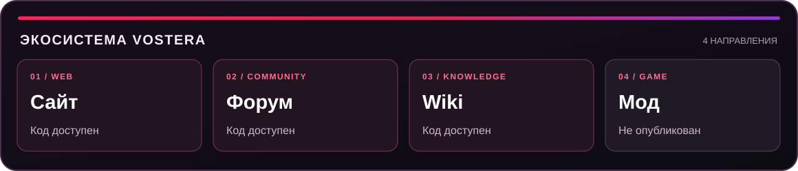

  

<h1 align="center">VOSTERA ROLEPLAY</h1>

  <strong>Твоя история начинается здесь.</strong> 
  Многопользовательский RP-проект на базе SA-MP / CR:MP.

  
  
  

  <a href="https://vk.ru/vostera_rp"><b>ВКонтакте</b></a> &nbsp;·&nbsp;
  <a href="https://t.me/vostera_rp"><b>Telegram</b></a> &nbsp;·&nbsp;
  <a href="https://github.com/Zeihos/Vostera-RP/issues"><b>Обсуждение разработки</b></a>

  <a href="#о-проекте">О проекте</a> &nbsp;•&nbsp;
  <a href="#состав-проекта">Разделы</a> &nbsp;•&nbsp;
  <a href="#быстрый-старт">Запуск</a> &nbsp;•&nbsp;
  <a href="#план-и-документация">Документация</a>

---

## О проекте

**VOSTERA ROLEPLAY** — игровой RP-проект с собственным оформлением и сервисами для сообщества. Здесь собираются сайт, форум, база знаний, инструменты контроля качества и материалы для будущего игрового сервера.

В основе стиля — тёмные оттенки, красные акценты и атмосфера автомобильной RP-игры. Все основные пользовательские материалы и документация ведутся на **русском языке**.

> [!NOTE]
> **Текущий этап — разработка.** Исходник игрового мода `vostera.pwn` и проверенный `vostera.amx` **пока не опубликованы**. Публичный игровой сервер и дата релиза не подтверждены. Сайт, форум и Wiki имеют исходный код и автоматические тесты, но перед публичным запуском требуют настройки и проверки на хостинге.

## Состав проекта

  

<table>
  <tr>
    <td width="50%" valign="top">
      <h3>🌐 <a href="./Сайт/">Сайт</a></h3>
      
Новости, информация о проекте, инструкция для новичков и мониторинг серверов SA-MP / open.mp.

      
PHP · CSS · JavaScript

      <a href="./Сайт/">Исходники сайта</a>
    </td>
    <td width="50%" valign="top">
      <h3>💬 <a href="./Форум/">Форум</a></h3>
      
Обсуждения, регистрация, профили, модерация, разделы сообщества и административная панель.

      
PHP 8.1+ · JSON-хранилище

      <a href="./Форум/INSTALL.txt">Инструкция установки</a>
    </td>
  </tr>
  <tr>
    <td width="50%" valign="top">
      <h3>📚 <a href="./Вики/">VOSTERA WIKI</a></h3>
      
База знаний: категории, поиск, статьи, редактор и разграничение прав доступа.

      
PHP 8.1+ · JSON-хранилище

      <a href="./Вики/INSTALL.txt">Инструкция установки</a>
    </td>
    <td width="50%" valign="top">
      <h3>🎮 <a href="./Мод/">Игровой мод</a></h3>
      
Подготовка компиляции Pawn, диагностика зависимостей, проверка безопасности и будущие игровые испытания.

      
Pawn · SA-MP / CR:MP · пока без опубликованного AMX

      <a href="https://github.com/Zeihos/Vostera-RP/issues/2">Текущая задача разработки</a>
    </td>
  </tr>
</table>

Фирменные аватарки, обложки и материалы публикаций находятся в каталоге **[Оформление](./Оформление/)**.

## Быстрый старт

Для локальной работы с веб-сервисами требуется **PHP 8.1+**. Для запуска проверок — **Python 3.10+**. Форум и Wiki не требуют отдельного MySQL-сервера.

<b>Открыть сайт локально</b>

Из корня репозитория:

~~~bash
php -S 127.0.0.1:8786 -t Сайт
~~~

Откройте http://127.0.0.1:8786. Чтобы отображался реальный онлайн, задайте адреса своих серверов в `Сайт/config/site.php`.

<b>Установить форум или Wiki</b>

У каждого сервиса должен быть **свой** виртуальный хост с корнем `public/`. Каталог `private/` не должен быть доступен из интернета.

В каталоге соответствующего сервиса:

~~~bash
php tools/prepare-install.php
~~~

Сохраните сгенерированный ключ **только у себя**, затем откройте `/install` и создайте владельца. Не добавляйте рабочие файлы и секреты в Git.

Подробности: [форум](./Форум/INSTALL.txt) · [Wiki](./Вики/INSTALL.txt) · [развёртывание](./docs/deploy.md).

<b>Запустить автоматические проверки</b>

Из корня репозитория:

~~~bash
python3 tools/check_repository.py
python3 tools/test_repository_policy.py
python3 tools/test_install_bootstrap.py
python3 tools/test_mod_preflight.py
python3 tools/test_web_smoke.py
php Сайт/tests/test_samp_query.php
~~~

Проверки PHP и веб-сервисов также выполняются через [GitHub Actions](https://github.com/Zeihos/Vostera-RP/actions). Они **не заменяют** компиляцию Pawn и игровые тесты.

## План и документация

| Документ | Для чего нужен |
|:--|:--|
| [План разработки](./docs/roadmap.md) | Приоритеты и условия подготовки к релизу |
| [Архитектура](./docs/structure.md) | Связи и назначение каталогов проекта |
| [Развёртывание](./docs/deploy.md) | Установка, безопасность и резервное копирование |
| [История изменений](./CHANGELOG.md) | Только фактически внесённые изменения |
| [Участие в разработке](./CONTRIBUTING.md) | Как предлагать исправления и Pull Request |
| [Безопасность](./SECURITY.md) · [Права на материалы](./NOTICE.md) | Ответственное раскрытие уязвимостей и условия использования файлов |

**Ближайшая цель:** получить исходники игрового мода, разрешённые к публикации, воспроизводимую компиляцию Pawn, рабочий AMX и результаты тестирования сервера с MariaDB. [Посмотреть задачу #2](https://github.com/Zeihos/Vostera-RP/issues/2).

---

  <b>VOSTERA ROLEPLAY</b> 
  Твоя история начинается здесь.  
  <a href="https://vk.ru/vostera_rp">VK</a> &nbsp;·&nbsp;
  <a href="https://t.me/vostera_rp">Telegram</a> &nbsp;·&nbsp;
  <a href="https://github.com/Zeihos/Vostera-RP/issues">GitHub Issues</a>

